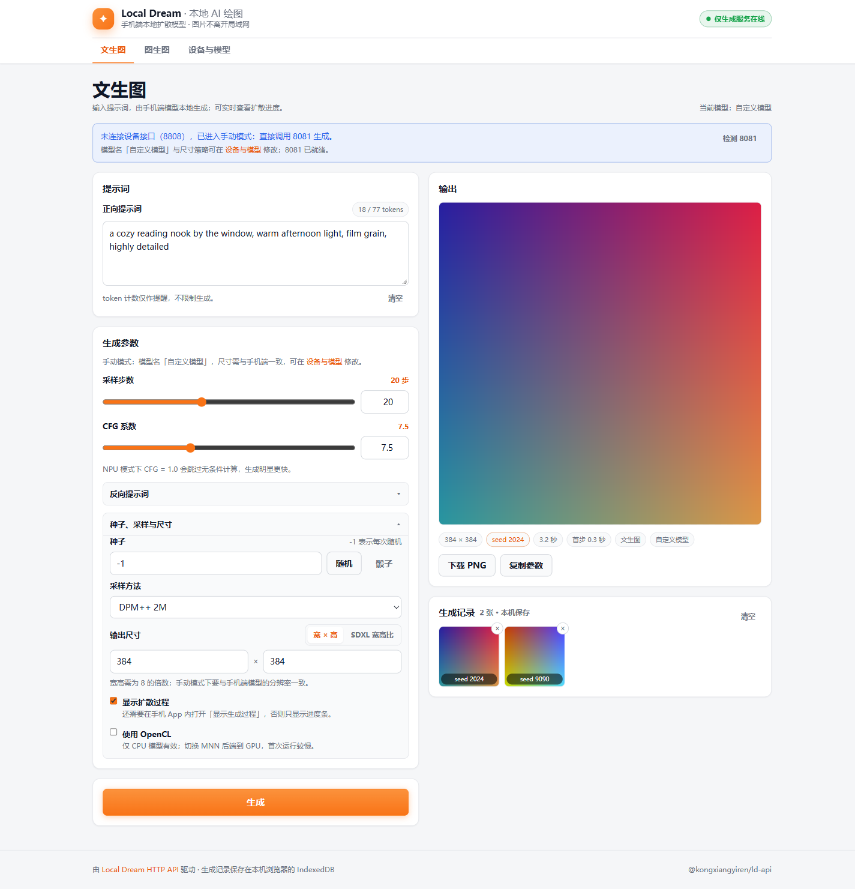
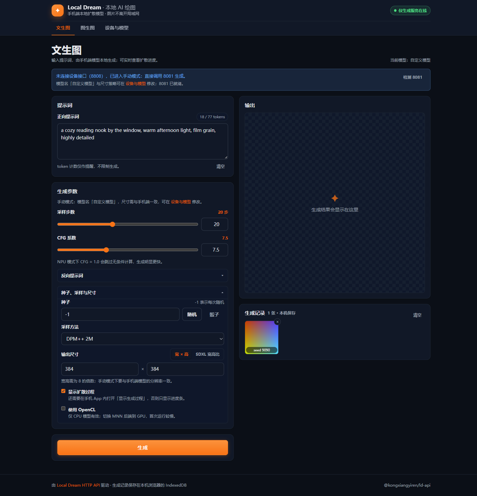
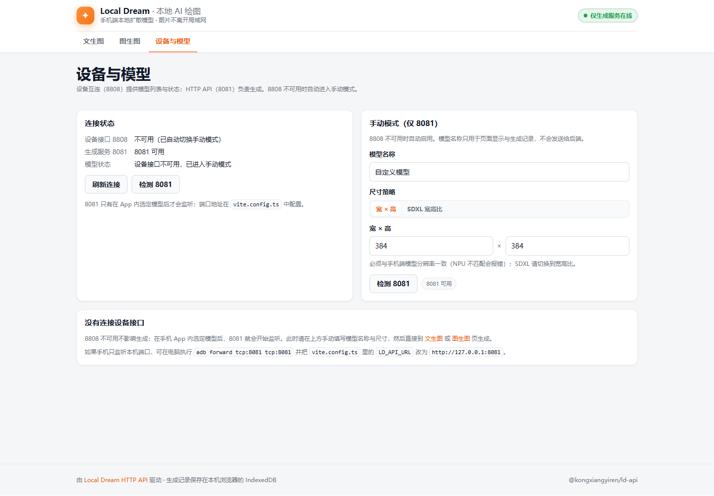
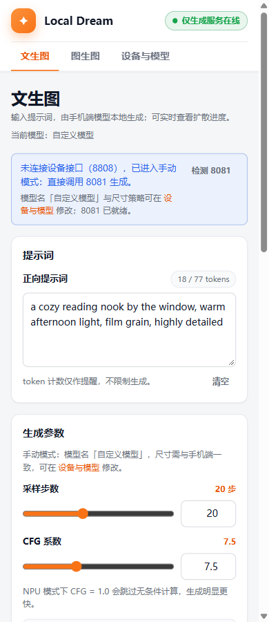
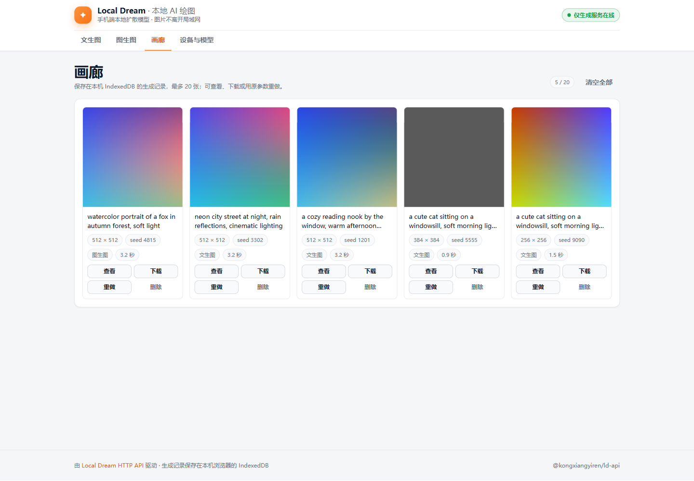
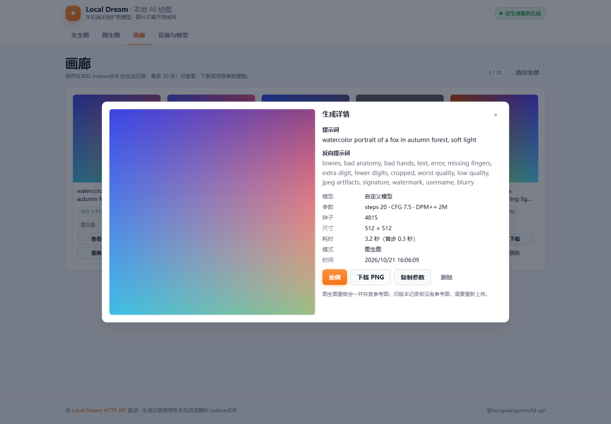
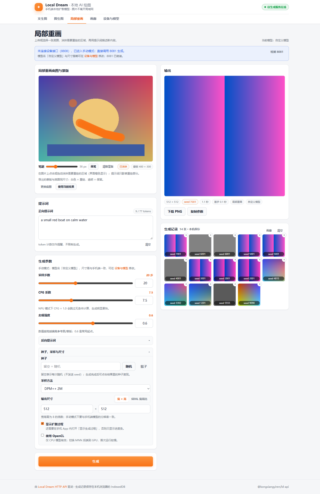
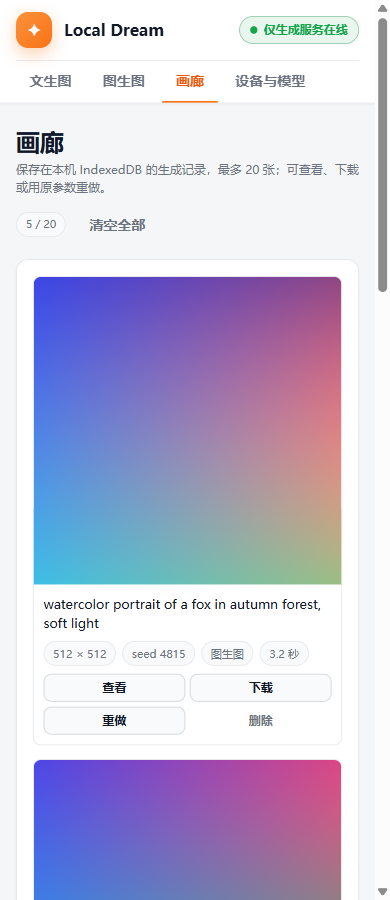

# Local Dream Web

Gradio 风格的本地 AI 绘图站：在浏览器里调用手机端 [Local Dream](https://ld-guide.chino.icu/) 的本地扩散模型，支持文生图、图生图、局部重画（mask）、扩散过程预览，以及带查看/下载/重做的本机画廊。

- 前端：Vue 3 + `<script setup>` + TypeScript + Vite
- 路由：`vue-router` 5 的文件路由（`src/pages` 即路由，自动生成 `typed-router.d.ts`）
- 状态：Pinia；持久化：localStorage（参数）+ IndexedDB（生成图片，`useIDBKeyval`）
- 样式：Tailwind CSS（布局）+ SCSS（Gradio 观感与明暗主题）
- API：[@kongxiangyiren/ld-api](https://github.com/kongxiangyiren/ld-api)

## 界面预览

以下截图由请求拦截的演示数据生成，仅展示界面状态。

| 文生图（浅色） | 文生图（深色） |
| --- | --- |
|  |  |

| 设备与模型 | 移动端 |
| --- | --- |
|  |  |

| 画廊 | 画廊详情 |
| --- | --- |
|  |  |

| 局部重画（蒙版涂抹） | 移动端画廊 |
| --- | --- |
|  |  |

## 前置条件

1. 手机安装 Local Dream（2.8.1+），并与运行本项目的电脑处于同一局域网。
2. **在 App 内选定并加载一个模型**。HTTP API（8081）只有在模型加载完成后才会监听，这是生成必需的。
3. 设备互连（8808）是可选能力：
   - 可用：自动读取模型列表、加载/停止模型、实时状态。
   - 不可用：自动进入**手动模式**，只要 8081 可访问就能生成；模型名称与尺寸在「设备与模型」页手动填写。

## 手机与 API 配置

前端始终请求**同源相对路径**，再由代理转发到手机，因此手机端不需要提供 CORS 头：

| 前端请求 | 转发到 | 用途 |
| --- | --- | --- |
| `/info` `/models` `/select` `/status` `/stop` | `LD_API_8808` | 设备互连（可选：模型列表、加载/停止、状态轮询） |
| `/tokenize` `/generate` | `LD_API_8081` | HTTP API（生成必需） |

### 本地开发（Vite 代理）

编辑 `vite.config.ts`，`dev` 与 `preview` 都使用同一份代理：

```ts
const LD_DEVICE_URL = 'http://192.168.1.40:8808' // 设备互连（可选）
const LD_API_URL = 'http://192.168.1.40:8081' // HTTP API（必需）
```

如果 8081 只监听手机本机，可先在电脑执行 `adb forward tcp:8081 tcp:8081`，再把 `LD_API_URL` 改成 `http://127.0.0.1:8081`。

### Docker 部署（nginx 代理）

镜像内没有构建期 API 地址，API 地址是**运行时环境变量**，改完只需重启容器，不用重新构建镜像：

```sh
# 默认使用 192.168.1.40:8808 / 192.168.1.40:8081
docker compose up -d --build

# 浏览器打开 http://<宿主机 IP>:2333
```

在 `docker-compose.yml` 里改 `LD_API_8808` / `LD_API_8081`，或在项目根目录新建 `.env`（Compose 会自动读取，且不会打进镜像）：

```ini
# .env
LD_API_8808=192.168.1.40:8808
LD_API_8081=192.168.1.40:8081
```

```sh
docker compose up -d
```

- 值格式为 `host:port`，**不要带 `http://`**。
- 容器启动时由 nginx 官方镜像的 envsubst 渲染 [nginx.conf.template](nginx.conf.template)；8808 不可用时前端会自动进入手动模式。
- `adb forward` 场景：容器里的 `127.0.0.1` 指向容器自身，应改填 `host.docker.internal:8081`（compose 已加入 `host-gateway` 映射）。
- 路由映射与超时（尤其是 `/generate` 的 SSE 不缓冲）都写在 nginx 模板里，修改后重建/重启容器生效。

### 静态部署

把 `dist/` 交给任意静态服务器，并按上表把 5 个设备路径与 2 个生成路径反代到手机；可直接参考 `nginx.conf.template` 的配置。SPA 路由需要 `try_files $uri $uri/ /index.html` 回退。

## 运行

```sh
pnpm install
pnpm dev
```

生产构建与预览：

```sh
pnpm build
pnpm preview
```

Docker：

```sh
docker compose up -d --build   # 打开 http://<宿主机 IP>:2333
docker compose logs -f ld-vue  # 查看 nginx / 代理日志
```

`.dockerignore` 已排除 `node_modules`、`dist`、文档与测试等构建无关内容；镜像构建阶段只执行 `pnpm build-only`（不跑 type-check，路由类型由 vue-router 插件生成）。

## 页面

| 路由 | 说明 |
| --- | --- |
| `/` | 文生图：提示词、负向提示词、步数/CFG/种子/采样器/尺寸、SSE 进度、扩散预览、下载与复制参数 |
| `/img2img` | 图生图：上传 PNG/JPEG 参考图 + 去噪强度；模型不支持时给出提示 |
| `/inpaint` | 局部重画：上传/载入底图，在画布上涂抹蒙版后生成；请求携带 `image + mask + denoise_strength` |
| `/gallery` | 画廊：查看大图与参数、下载 PNG、用原参数/种子重做（图生图/局部重画会恢复参考图与蒙版）、局部重画、删除单条或清空 |
| `/settings` | 设备互连状态、8081 探测、模型列表与分辨率、加载/停止模型、手动模式（自定义模型名 / 宽高 / SDXL 宽高比） |

新增页面只需在 `src/pages` 下创建 `.vue` 文件，文件名即路由路径。

## 模式与尺寸

| 场景 | 行为 |
| --- | --- |
| 8808 可用 + 模型运行中 | 完整设备能力；状态每 3 秒轮询 |
| 8808 可用 + 未加载模型 | 生成按钮禁用，引导到「设备与模型」页 |
| 8808 不可用 | 自动手动模式；只用 8081，`/tokenize` 失败只影响计数显示 |
| SDXL NPU | 只发送 `aspect_ratio`（长边 1024，短边向上取 8 的倍数） |
| SD1.5 NPU | 必须使用加载模型时选定的分辨率 |
| SD1.5 CPU | 任意 8 的倍数宽高（64–1536） |

token 计数只作提醒：超过 77 会显示黄色提示，但不会阻止生成。

种子留空表示每次随机，此时请求里**不会发送 `seed` 字段**；想复现就填入结果里的种子（或点结果上的 seed 标签）。

切换模型（加载模型）时，会应用模型列表里的默认提示词、反向提示词（仅在非空时覆盖）以及 steps / CFG / 采样器。

## 局部重画（mask）

`/inpaint` 页面：

- **底图**：上传 PNG/JPEG，或在文生图/图生图输出、画廊详情里点「局部重画」，把已有图片作为底图。
- **涂抹蒙版**：在图上点击/拖动鼠标圈出要重绘的区域（界面显示橙色），可调笔刷大小、切换橡皮擦、清除蒙版；只有涂抹区域会被重绘。导出的蒙版与底图同尺寸：**白色 = 重绘，透明 = 保留**。
- **参数**：提示词、反向提示词、steps/CFG/采样器、去噪强度等与图生图共用；去噪强度越高，重绘区域变化越大。
- **重做**：蒙版会随生成记录保存到 IndexedDB，画廊「重做」会恢复底图与涂抹区域，确认后再点「生成」。

## 生成记录与画廊

生成图片与参数保存在浏览器 IndexedDB（最多 20 条），刷新页面后仍可查看。生成页底部显示最近记录，`/gallery` 提供完整画廊：

- **查看**：打开详情弹窗，展示完整图片、提示词、采样参数、耗时与时间。
- **下载**：保存为 `local-dream-{seed}-{width}x{height}.png`。
- **重做**：还原提示词、负向提示词、步数/CFG/采样器、种子、尺寸/宽高比与去噪强度，并跳到对应生成页（图生图恢复参考图，局部重画恢复底图与蒙版），确认后再点「生成」。
- **局部重画**：把这张图作为底图进入 `/inpaint`。
- **删除 / 清空**：单条删除或清空全部；生成过程中的中间预览只走 SSE，不写入 IndexedDB。

## 常用命令

```sh
pnpm type-check   # vue-tsc
pnpm test:unit    # Vitest（--run 单次执行）
pnpm lint         # oxlint + eslint
pnpm format       # oxfmt src/
```

> `@vueuse/integrations` 目前只用到 `useIDBKeyval`（依赖已安装的 `idb-keyval`）。其余集成（useAxios/useQRCode/useDrauu/useSortable 等）需要额外 peer 依赖，按需再装。

## 已知限制

- 扩散过程预览依赖手机 App 内打开「显示生成过程」；未打开时仍显示进度条。
- 中间预览若与请求尺寸不一致会被跳过（不影响最终图）。
- 生成记录存在浏览器里，换浏览器/清理站点数据后会丢失。
- 图生图/局部重画重做依赖记录里保存的底图；旧记录没有参考图或蒙版时需要重新上传/涂抹。
- 局部重画按「白色 = 重绘、透明 = 保留」导出与底图同尺寸的蒙版；若手机端的实现语义相反，需要调整蒙版导出。
- 未实现超分、批量生成与公网鉴权。
